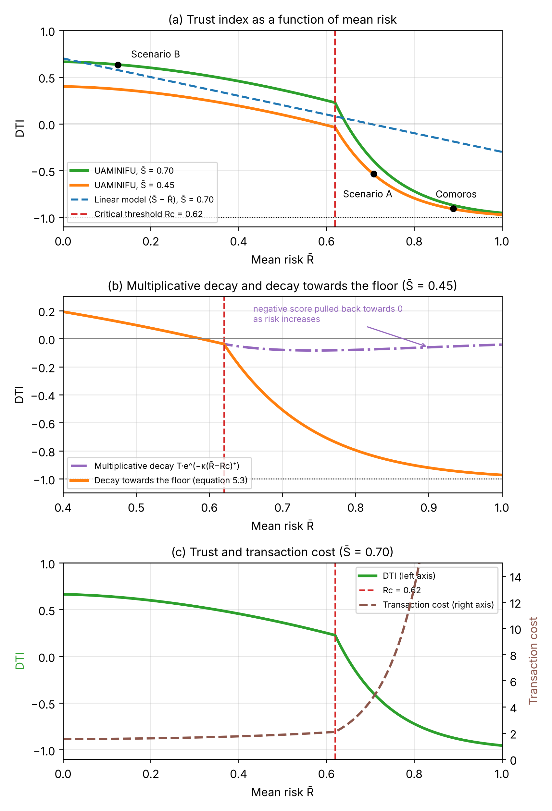
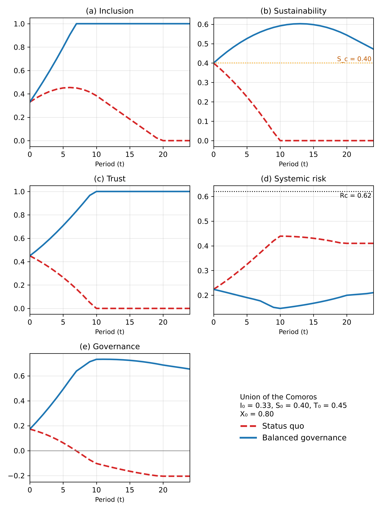

# Systemic digital governance: I–S–T modelling

[](LICENSE)
[](https://www.python.org/)
[](https://doi.org/10.5281/zenodo.20242474)

[Français](README.md) · **English**

> **Code repository accompanying the doctoral thesis:**
>
> *Gouvernance du numérique à l'ère de l'IA : modélisation systémique
> de l'inclusion, de la soutenabilité et de la confiance*
> (Digital governance in the age of AI: systemic modelling of inclusion,
> sustainability and trust)
>
> **Karim Attoumani Mohamed** & **Jérôme Velo**
> University of Toamasina — Faculty of Sciences and Technologies
> Doctoral thesis in Computer Science (Computer Engineering)
> ÉAD MIASE — SCSD Doctoral School, 2026

The thesis is written in French (official version). An English translation is
provided as a complementary version; the figures of both versions are produced
by the scripts of this repository.

---

## About this research

The thesis proposes an integrated systemic framework for digital governance
linking three interdependent structuring variables:

- **I — Inclusion**: the capacity of actors to participate effectively in
  governance spaces and in the benefits of digital technology
- **S — Sustainability**: the capacity of digital infrastructures to operate
  durably under energy, computational and environmental constraints
- **T — Trust**: the condition of legitimacy and stability of digital
  interactions

These three variables are formalised in a dynamic governance model G(t):

```
G_t = α·I_t^γ + β·S_t^δ + χ·T_t^θ − φ·R_t

R_t = r₁·A_t·I_t·(1−S_t) + r₂·(1−T_t)·X_t + r₃·A_t·X_t
```

where R_t is systemic risk, A_t the intensity of AI use and X_t the external
dependence of the system.

**Parameter values** (set by assumption and explored through sensitivity
analysis, not estimated from data):

| Parameter | Value | Description |
|-----------|-------|-------------|
| α | 0.35 | Weight of inclusion I |
| β | 0.35 | Weight of sustainability S |
| χ | 0.30 | Weight of trust T |
| γ | 1.15 | Non-linearity exponent of I |
| δ | 1.55 | Non-linearity exponent of S |
| θ | 1.35 | Non-linearity exponent of T |
| φ | 0.50 | Sensitivity to systemic risk |
| Rc | 0.62 | Critical threshold for the degradation of T |
| κ | 7.0 | Rate of exponential decay of T |

---

## Related publications

The thesis is structured as a thesis by publication. Two published
contributions and one working paper integrated into the thesis form the
empirical pillars of the variables I, S and T.

| Contribution | Status | Variable | DOI |
|---|---|---|---|
| Karim & Velo (2025a) — *Towards Inclusive Internet Governance: A Multidimensional Analysis of Systemic Barriers and Reform Strategies* | **Published** — IEEE ICECER 2025 | I | [10.1109/ICECER65523.2025.11401243](https://doi.org/10.1109/ICECER65523.2025.11401243) |
| Karim & Velo (2025b) — *Towards Sustainable Internet Governance: Energy and Bandwidth Challenges in the Era of AI* | **Published** — IEEE ICECER 2025 | S | [10.1109/ICECER65523.2025.11401095](https://doi.org/10.1109/ICECER65523.2025.11401095) |
| Karim & Velo (2026) — *UAMINIFU: Modeling Digital Trust as a Systemic and Economic Variable for AI-Driven Digital Sovereignty* | **Working paper** integrated into the thesis (Chapter 5), to be submitted | T | — |

---

## Repository contents

Script and file names are in French, as in the thesis.

```
these-gouvernance-numerique-IST/
│
├── README.md                        ← Guide in French
├── README_EN.md                     ← This guide (installation, reproduction, scope)
├── CITATION.cff                     ← Citation metadata ("Cite this repository" button)
├── .zenodo.json                     ← Zenodo archive metadata
├── LICENSE                          ← MIT licence (code)
├── requirements.txt                 ← Python dependencies
│
├── simulation/
│   ├── generate_figures.py          ← Model G(t), scenarios, Figures 3.1, 3.2, 4.2
│   ├── energie.py                   ← Table 4.I and Figure 4.1 (AI-related demand in 2030)
│   ├── dti.py                       ← Revised DTI, Table 5.IV, scenarios A and B, sensitivity
│   ├── figure_5_1_dti.py            ← Figure 5.1
│   ├── figure_6_1_diagramme_causal.py ← Figure 6.1
│   ├── figure_6_2_6_3.py            ← Figures 6.2 and 6.3 (manuscript layout)
│   ├── figure_6_4_comores.py        ← Figure 6.4
│   ├── sensibilite_parametres.py    ← 42 one-at-a-time simulations
│   ├── analyses_ch6.py              ← Monte Carlo, coupled variant, levers, initial values
│   ├── icann86_codage.py            ← I-S-T coding of the 25 ICANN86 sessions (Appendix C)
│   └── en/                          ← Figure scripts of the English version (translated labels)
│
├── resultats/                       ← Reference numerical outputs of the scripts
├── figures_these/                   ← Figures of the manuscript (thesis numbering)
├── figures_these_en/                ← Figures of the English version of the manuscript
├── figures/                         ← Figures of version 2.0 (historical)
│
└── data/
    ├── icann86_sessions.csv         ← I, S, T counts of the 25 ICANN86 sessions
    ├── README_donnees.md            ← Data sources and assumptions (French)
    └── README_data_EN.md            ← Data sources and assumptions (English)
```

### Correspondence between manuscript figures and scripts

| Manuscript figure | Script (`simulation/`) | Output file (`figures_these/`) | English version (`simulation/en/` → `figures_these_en/`) |
|---|---|---|---|
| 3.1 | `generate_figures.py` → `generate_figure_3_1` | `Figure_3_1_DSGM_reseau_participation` | already in English (IEEE article) |
| 3.2 | `generate_figures.py` → `generate_figure_3_2` | `Figure_3_2_participation_scenarios` | already in English (IEEE article) |
| 4.1 | `energie.py` | `Figure_4_1_demande_IA` | `figure_4_1_ai_demand_en.py` → `Figure_4_1_AI_demand` |
| 4.2 | `generate_figures.py` → `generate_figure_4_2` | `Figure_4_2_lambda_orchestration` | already in English (IEEE article) |
| 5.1 | `figure_5_1_dti.py` | `Figure_5_1_DTI` | `figure_5_1_dti_en.py` → `Figure_5_1_DTI` |
| 6.1 | `figure_6_1_diagramme_causal.py` | `Figure_6_1_diagramme_causal` | `figure_6_1_causal_loop_en.py` → `Figure_6_1_causal_loop_diagram` |
| 6.2 | `figure_6_2_6_3.py` | `Figure_6_2_quatre_scenarios` | `figure_6_2_6_3_en.py` → `Figure_6_2_four_scenarios` |
| 6.3 | `figure_6_2_6_3.py` | `Figure_6_3_sensibilite_lambda` | `figure_6_2_6_3_en.py` → `Figure_6_3_lambda_sensitivity` |
| 6.4 | `figure_6_4_comores.py` | `Figure_6_4_cas_Comores` | `figure_6_4_comoros_en.py` → `Figure_6_4_Comoros_case` |

The functions `generate_figure_4_1`, `generate_figure_5_1`, `generate_figure_6_1`,
`generate_figure_6_2` and `generate_figure_6_3` of `generate_figures.py` produce
the figures of version 2.0; they are kept for the record and no longer match the
manuscript. `figure_6_2_6_3.py` reuses the simulations of `generate_figure_6_1`
and `generate_figure_6_2` (same scenarios, same parameters) in the manuscript
layout.

Each English script translates the labels of the corresponding French script
and uses decimal points; it imports the model from `simulation/` and changes no
parameter.

### Reproducing the results of the manuscript

```bash
pip install -r requirements.txt
cd simulation
python dti.py                       # Chapter 5; reference output: resultats/dti.txt
python energie.py                   # Chapter 4; resultats/energie.txt
python sensibilite_parametres.py    # resultats/sensibilite_un_a_la_fois.txt
python analyses_ch6.py              # resultats/analyses_ch6.txt (seed 2026)
python icann86_codage.py            # Appendix C; resultats/icann86_synthese.txt
python figure_5_1_dti.py ; python figure_6_1_diagramme_causal.py ; python figure_6_2_6_3.py ; python figure_6_4_comores.py

# English figures
cd en
python figure_4_1_ai_demand_en.py ; python figure_5_1_dti_en.py ; python figure_6_1_causal_loop_en.py
python figure_6_2_6_3_en.py ; python figure_6_4_comoros_en.py
```

Parameters: `ModelParameters` in `generate_figures.py` (α = 0.35; β = 0.35;
χ = 0.30; γ = 1.15; δ = 1.55; θ = 1.35; r₁ = 0.40; r₂ = 0.35; r₃ = 0.25;
φ = 0.50; Rc = 0.62; κ = 7.0; coefficients of Equations 6.1 to 6.3: 0.08;
−0.10; 0.05; −0.12; 0.06; 0.09; 0.07; −0.08; Sc = 0.40). Comoros: I₀ = 0.33;
S₀ = 0.40; T₀ = 0.45; X₀ = 0.80; A from 0.25 to 0.65; 25 periods. DTI: factors
and interactions of Tables 5.I to 5.III, reproduced in `dti.py`. Random draws:
seed 2026. The console outputs of the scripts (`resultats/`) are in French.

### Scope of reproducibility

- **Reproducible from this repository**: all simulations and calculations of
  Chapters 4, 5 and 6 (Tables 4.I, 5.IV, 6.II; robustness analyses;
  Figures 4.1 to 6.4). The reference outputs are in `resultats/`.
- **Reproducible with the ICANN transcripts**: the coding of the 25 ICANN86 sessions (Section 6.3.7, Appendix C). `data/icann86_sessions.csv` holds the counts per session, from which `icann86_codage.py` derives the summary of Appendix C. The same script recomputes the counts from the VTT transcripts published by ICANN (`--transcripts FOLDER`), which are not redistributed here; the session chats are not used.
- **Partially reproducible**: Chapter 3. The scripts regenerate the DSGM
  visualisations and simulations (Figures 3.1 and 3.2) from weights and
  parameters set in the code. They redo neither the extraction of the
  historical IGF/IETF data nor the statistical calculations of the article
  (R² = 0.82, confidence interval): these values are taken from Karim & Velo
  (2025a) and are not recomputed. The historical datasets are not included in
  this repository.
- **Not published**: the individual answers to the two questionnaires (n = 8
  and n = 9), which contain personal data; only aggregated results appear in
  the thesis.

---

## Installation

### Requirements

- Python 3.9 or later
- pip

### Clone the repository

```bash
git clone https://github.com/karimattoumanimohamed/these-gouvernance-numerique-IST
cd these-gouvernance-numerique-IST
```

### Install the dependencies

```bash
pip install -r requirements.txt
```

---

## Usage

### Generating the figures of the manuscript

The nine figures of the manuscript are obtained with the commands of the
section "Reproducing the results of the manuscript" above, together with
`generate_figures.py` for Figures 3.1, 3.2 and 4.2. Each script saves its
figures in the current directory, as PNG and SVG (Figure 6.1: PNG only).

`python simulation/generate_figures.py` also produces the eight historical
figures of version 2.0 (folder `figures/`), which no longer match the
manuscript for 4.1, 5.1 and 6.1 to 6.3.

### Changing the model parameters

The parameters of the model G(t) are gathered in the `ModelParameters` class
(Section 7 of the code). To explore other configurations:

```python
from simulation.generate_figures import ModelParameters, run_simulation_G

# Change the parameters
params = ModelParameters(
    gamma=1.20,   # Increase the non-linearity of I
    delta=1.60,   # Increase the non-linearity of S
    Rc=0.55       # Lower the critical threshold of T
)

# Run a custom simulation
# (see Section 7 for the definition of ScenarioConfig)
```

### Applying the model to a new context

To adapt the model to another country or context of the Global South, change
the initial conditions and the trajectories of A and X in
`figure_6_4_comores.py`:

```python
# Example: adapting to the context of Vanuatu
# ScenarioConfig(name, I0, S0, T0, A, X, inclusion, investment, audit, colour, style)
sc_custom = g.ScenarioConfig("Vanuatu — Status quo",
    0.28, 0.38, 0.42,      # I0, S0, T0: values to be estimated from public sources
    A, [0.80]*T,           # intensity of AI use, external dependence
    False, False, False, '#d62728', '--')
hist = g.run_simulation_G(sc_custom, g.ModelParameters(), T)
```

---

## Figures

The nine figures of the manuscript are in `figures_these/`, and the English
versions in `figures_these_en/`, for example:





---

## Key results

The results below are those of the final manuscript of the thesis (2026).
Where they differ from those of the articles, the difference is indicated; see
also the section [From the articles to the thesis](#from-the-articles-to-the-thesis-versions-20-and-3x).

### Participation asymmetries (Figure 3.1 — Karim & Velo, 2025a)
- 92% of leadership positions at the IETF are held by the Global North
- The geographical proximity of meeting venues explains 68% of the variance
  in participation (R² = 0.68, p < 0.01)
- Targeted reforms could increase Global South participation by 120 to 150%
  over five years (DSGM model, R² = 0.82)

### Energy constraints (Figures 4.1 and 4.2 — Karim & Velo, 2025b)
- An AI interaction consumes 145 to 250 times more energy than web use
  according to the estimates published in 2023 and used by the article; about
  12 to 15 times according to the measurements published in 2025 (Epoch AI;
  Google)
- In 2030, for 600 million users, AI-related demand represents 6.6 to 11.3% of
  African electricity generation under the high assumption (full adoption,
  100 requests per day, 2.9 to 5 Wh per request), but less than 1% under the
  low assumption (0.24 to 0.3 Wh per request), whatever the usage profile
  (thesis, Table 4.I)
- The orchestration coefficient λ makes an invisible computing load visible;
  the article sets an indicative threshold around λ ≈ 40, which is not derived
  from a capacity measurement

### Trust degradation (Figure 5.1 — UAMINIFU framework, Chapter 5)
- Revised DTI: computed on the means of the factors, with decay towards the
  floor −1 beyond Rc = 0.62; the DTI is bounded in [−1, 1] and decreases with
  each risk factor
- Transaction cost: Ctx = C₀ + ω/τ^η, with τ = (1 + DTI)/2
- Comoros (public sources and expert elicitation): DTI = −0.908, collapse zone
  in the sense of the UAMINIFU model; −0.94 to −0.87 depending on the variants
  tested (thesis, § 5.6)

### Governance dynamics (Figures 6.1 to 6.4 — model G(t))
- Improving one variable in isolation does not guarantee an improvement of G
- Scenarios 1 and 2 deteriorate, scenarios 3 and 4 improve and remain the
  best ranked in 98% of 2,000 draws in which the 21 parameters vary
  simultaneously by ±50% (thesis, § 6.1.8)
- Viability region (thesis, § 6.2.3): with investment, A ≤ 0.5 and active
  audit, no state of K = {I ≥ 0.4, S ≥ 0.45, T ≥ 0.5} leaves it
- Case of the Comoros (25 periods): G = −0.205 under the status quo versus
  G = 0.654 under balanced governance; same conclusion for the 81 combinations
  of initial values tested

---

## From the articles to the thesis (versions 2.0 and 3.x)

Version 3.0 (October 2026) accompanies the revision of the manuscript: revised
DTI (bounded and monotonic), energy projections recomputed without double
projection for the year 2030, X₀ = 0.80 for the Comoros, robustness analyses
and figures under the thesis numbering. The corresponding calculations are in
the scripts listed above. Version 3.0.1 harmonises the labels of Figure 5.1
(script and image) with the manuscript; the numerical results are unchanged.
Version 3.1.0 consolidates the repository for the French and English versions
of the manuscript: `figure_6_2_6_3.py` produces Figures 6.2 and 6.3 in the
manuscript layout (the folder `figures_these/` previously held the versions
from `generate_figures.py`, with identical data but a different layout);
scripts and figures of the English version (`simulation/en/`,
`figures_these_en/`); coding of the ICANN86 sessions (`icann86_codage.py`,
`data/icann86_sessions.csv`), announced in the thesis but missing from earlier
versions; English documentation (`README_EN.md`, `data/README_data_EN.md`); citation metadata (`CITATION.cff`, `.zenodo.json`).
The numerical results are unchanged.

Version 1.0 of this repository (2025) reproduced the results of the articles.
Version 2.0 (2026) aligned the repository with the final manuscript. **No
calculation was changed**: the curves are identical; only labels, annotations
and comments changed.

The following table describes the changes of version 2.0; it uses the figure
and section numbering of that version.

| Item | Version 1.0 | Version 2.0 | Thesis reference |
|---|---|---|---|
| Figure 4.1 — energy threshold | Line "15% of African capacity ≈ 131 GWh/day" and line "% of African capacity" (53.6%) computed on 874 GWh/day | Removed: the denominator 874 was not sourced; it probably corresponds to African electricity demand in 2019 (874 TWh/year) read as GWh/day | § 4.3 |
| Figure 4.1 — E₀ | E₀ = 174 GWh/day presented as the consumption in 2024 | E₀ corresponds to the demand of 600 M users in 2030; scenario B is an upper bound | § 4.3 |
| Figure 4.2 — λ_c | "Critical threshold λ_c = 40", "African capacity systematically exceeded" | "Indicative threshold λ ≈ 40 (assumption of the article)" | § 4.3.4 |
| Figure 5.1 — transaction cost | Ctx = C₀ + θ/T^η | Ctx = C₀ + ω/T^η (θ is reserved for the exponent of T in G(t)) | Ch. 5 |
| Figure 5.1 — source | "Submitted manuscript, CARI 2026" | UAMINIFU framework, Chapter 5 (working paper) | Ch. 5 |
| Figure 5.1 — scenarios A and B | Points DTI = −1.06 and 3.59 placed on panel C, off the curve | Values recomputed with the exact exponents and the decay on R̄ = ΣRⱼ/6 (convention of § 5.6.4), i.e. −2.69 and 3.60, shown in a box with the DTI of the Comoros (−1.73): they do not belong to the stylised cross-section plotted | § 5.4.2 |
| Figure 6.1 — green band | "Stable governance zone" | "Indicative band 0.3 < G < 0.7" | § 6.4.1 |
| Figure 6.2 | Annotation "λ_c ≈ 40 (African critical threshold)"; threshold S_c also plotted on panel G | Annotation removed; saturation A_t = 1 for λ ≥ 34 indicated; S_c plotted on panel S only | § 6.4.2 |
| Figure 6.3 | Line "initial S₀" plotted at 0.33 (value of I₀) | Line removed | § 6.5 |
| Formats | PNG 300 dpi | PNG 300 dpi and vector SVG | Appendix A |

---

## Reproducibility and FAIR principles

This repository follows the FAIR principles (Wilkinson et al., 2016):

- **Findability** — repository indexed on GitHub with a permanent Zenodo DOI
- **Accessibility** — code and figures freely available under the MIT licence
- **Interoperability** — standard formats: Python 3.9+, PNG 300 dpi, SVG,
  Markdown
- **Reusability** — complete documentation, detailed parameters, explicit
  licence, easy extension to other contexts

**FAIR reference:**
Wilkinson, M. D., et al. (2016). The FAIR Guiding Principles for scientific
data management and stewardship. *Scientific Data, 3*, 160018.
https://doi.org/10.1038/sdata.2016.18

---

## Citation

**Zenodo archive**

| Version | DOI |
|---|---|
| All versions (concept DOI, resolves to the latest version) | [10.5281/zenodo.20242474](https://doi.org/10.5281/zenodo.20242474) |
| v3.1.0 — consolidation of the French and English versions, ICANN86 coding; version cited in the thesis | [10.5281/zenodo.23591446](https://doi.org/10.5281/zenodo.23591446) |
| v3.0 — revised version of the thesis (October 2026) | [10.5281/zenodo.23557473](https://doi.org/10.5281/zenodo.23557473) |
| v3.0.1 — labels of Figure 5.1 harmonised with the manuscript | [10.5281/zenodo.23562079](https://doi.org/10.5281/zenodo.23562079) |
| v2.0 — version of the thesis (2026) | [10.5281/zenodo.23063106](https://doi.org/10.5281/zenodo.23063106) |
| v1.0 — state of the published articles (2025) | [10.5281/zenodo.20242475](https://doi.org/10.5281/zenodo.20242475) |

If you use this code or these results in your work, please cite:

```bibtex
@phdthesis{karim2026these,
  author  = {Karim Attoumani Mohamed},
  title   = {Gouvernance du num{\'e}rique {\`a} l'{\`e}re de l'{IA} :
             mod{\'e}lisation syst{\'e}mique de l'inclusion, de la
             soutenabilit{\'e} et de la confiance},
  school  = {Universit{\'e} de Toamasina},
  year    = {2026},
  type    = {Th{\`e}se de doctorat en Informatique
             (G{\'e}nie informatique)},
  url     = {https://github.com/karimattoumanimohamed/
             these-gouvernance-numerique-IST}
}

@inproceedings{karim2025a,
  author    = {Karim, A. M. and Velo, J.},
  title     = {Towards Inclusive Internet Governance: A Multidimensional
               Analysis of Systemic Barriers and Reform Strategies},
  booktitle = {Proceedings of ICECER 2025},
  year      = {2025},
  doi       = {10.1109/ICECER65523.2025.11401243}
}

@inproceedings{karim2025b,
  author    = {Karim, A. M. and Velo, J.},
  title     = {Towards Sustainable Internet Governance: Energy and
               Bandwidth Challenges in the Era of AI},
  booktitle = {Proceedings of ICECER 2025},
  year      = {2025},
  doi       = {10.1109/ICECER65523.2025.11401095}
}

@software{karim2026code,
  author    = {Karim Attoumani Mohamed and Jérôme Velo},
  title     = {these-gouvernance-numerique-IST : code source et figures
               de la th{\`e}se (version 3.1.0)},
  year      = {2026},
  publisher = {Zenodo},
  version   = {v3.1.0},
  doi       = {10.5281/zenodo.23591446}
}

@unpublished{karim2026uaminifu,
  author = {Karim, A. M. and Velo, J.},
  title  = {UAMINIFU: Modeling Digital Trust as a Systemic and Economic
            Variable for AI-Driven Digital Sovereignty},
  note   = {Working paper integrated into the thesis,
            University of Toamasina},
  year   = {2026}
}
```

---

## Licence

The code of this repository is distributed under the **MIT** licence.
You are free to use, modify and redistribute it provided the original authors
are credited. Texts and figures taken from the articles published by the IEEE
(Karim & Velo, 2025a, 2025b) remain subject to the IEEE reuse conditions and
are not covered by this licence.

See the [LICENSE](LICENSE) file for the full terms.

---

## Contact

**Karim Attoumani Mohamed**
University of Toamasina — Faculty of Sciences and Technologies
attoukarim@gmail.com

**Jérôme Velo** (thesis supervisor)
University of Toamasina — Faculty of Sciences and Technologies
zjvelo@gmail.com

---

*Repository created in 2025 — Version 3.1.0 (October 2026), aligned with the revised manuscript of the thesis and its English version*
